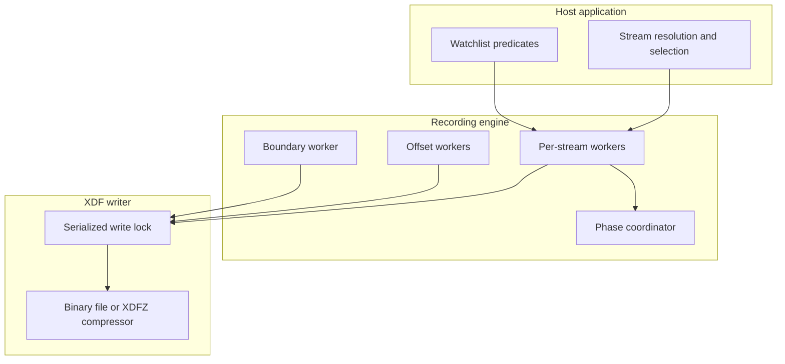

# LSL Receive → XDF Write Specification

## Goal

Author a **complete, language-agnostic technical specification** of how LabRecorder receives LSL streams and writes `.xdf` / `.xdfz` files, derived from the reference C++ implementation in [App-LabRecorder](file:///Users/pho/repo/EmotivEpocRepos2025/ACTIVE_DEV/App-LabRecorder). The spec is the contract for implementing the same behavior in [lab-recorder-python](file:///Users/pho/repo/EmotivEpocRepos2025/ACTIVE_DEV/lab-recorder-python) and later in Rust.

This pass writes documentation only—no Python/C++/Rust code changes.

## Source of truth (reference code)

| Layer | Reference |
|-------|-----------|
| Recording orchestration | [`src/recording.h`](file:///Users/pho/repo/EmotivEpocRepos2025/ACTIVE_DEV/App-LabRecorder/src/recording.h), [`src/recording.cpp`](file:///Users/pho/repo/EmotivEpocRepos2025/ACTIVE_DEV/App-LabRecorder/src/recording.cpp) |
| XDF binary writer | [`xdfwriter/xdfwriter.h`](file:///Users/pho/repo/EmotivEpocRepos2025/ACTIVE_DEV/App-LabRecorder/xdfwriter/xdfwriter.h), [`xdfwriter/xdfwriter.cpp`](file:///Users/pho/repo/EmotivEpocRepos2025/ACTIVE_DEV/App-LabRecorder/xdfwriter/xdfwriter.cpp), [`xdfwriter/conversions.h`](file:///Users/pho/repo/EmotivEpocRepos2025/ACTIVE_DEV/App-LabRecorder/xdfwriter/conversions.h) |
| Golden writer fixture | [`xdfwriter/test_xdf_writer.cpp`](file:///Users/pho/repo/EmotivEpocRepos2025/ACTIVE_DEV/App-LabRecorder/xdfwriter/test_xdf_writer.cpp) |
| CLI entry (minimal API surface) | [`src/clirecorder.cpp`](file:///Users/pho/repo/EmotivEpocRepos2025/ACTIVE_DEV/App-LabRecorder/src/clirecorder.cpp) |

Out of scope for the core spec: Qt GUI layout, BIDS filename templates, RCS TCP protocol details. Those may be noted as “host application concerns” only.

## Deliverable locations

1. **Primary SoT:** [`App-LabRecorder/docs/lsl-xdf-recording-spec.md`](file:///Users/pho/repo/EmotivEpocRepos2025/ACTIVE_DEV/App-LabRecorder/docs/lsl-xdf-recording-spec.md)  
   - Normative, language-agnostic, versioned (`Spec Version 1.0`, tied to observed LabRecorder behavior).
2. **Consumer pointer:** short section or `docs/SPEC.md` link in lab-recorder-python pointing at that file (or a vendored copy if cross-repo linking is awkward). Prefer a **copy or symlink-friendly path** under lab-recorder-python only if the two trees are not always checked out together; default is one SoT file in App-LabRecorder plus a README pointer in Python.

## Spec structure (what will be written)

### 1. Scope, conformance levels, glossary

- **MUST**: XDF 1.0 on-disk layout (chunks, endianness, XML payloads) required for pyxdf / LabRecorder interoperability.
- **SHOULD**: Behavioral parity with App-LabRecorder recording engine (pull cadence, timestamp compression, phase barriers, watchlist semantics).
- **MAY**: Host features (GUI, RCS, file naming).

Define terms: stream UID, source_id, streamid (XDF), phase-locked vs late stream, CollectionTime vs OffsetValue, implicit timestamp (`0`).

### 2. System architecture (abstract)

Language-neutral components and responsibilities:

Normative rules:
- One writer instance per output file; **all chunk writes serialized**.
- No requirement that implementations use C++’s exact thread count, but they **SHOULD** preserve observable file ordering constraints for phase-locked streams (all initial StreamHeaders before any Samples/ClockOffsets from that set; footers after streaming ends).
- Stream IDs allocated monotonically starting at **1** (`fresh_streamid` = `++streamid_` with init 0).

### 3. Recording lifecycle (normative algorithm)

Document the three phases from `record_from_streaminfo`:

1. **Headers:** create inlet → optional `set_postprocessing` → `open_stream(5s)` (timeout is non-fatal) → write StreamHeader from `inlet.info().as_xml()`.
2. **Streaming:** wait for phase barrier (10s max) → typed transfer loop → optional offset thread.
3. **Footers:** wait for phase barrier (2s max) → write StreamFooter XML → done.

Shutdown: set shutdown flag; transfer loops exit; join with timeout then detach semantics as observed (document risk).

Late / watchlist streams: `phase_locked=false`; may interleave mid-file; discover by LSL predicate every 5s; dedupe by UID and non-empty `source_id`.

### 4. LSL inlet and pull semantics (SHOULD for parity)

| Behavior | Spec value (from C++) |
|----------|----------------------|
| First sample | `pull_sample` with 4.0s timeout, repeat until non-zero ts or shutdown |
| Ongoing | `pull_chunk_multiplexed` with **1e-6** s timeout |
| Poll cadence | sleep until `next_pull += 500ms` |
| Formats | int8, int16, int32, float32, double64, string — **not** int64 |
| Inlet buffering | LSL defaults unless host sets postprocessing flags |
| Clock offsets | every 5s: `offset = time_correction(2)`, `now = local_clock()`, write ClockOffset with CollectionTime=`now-offset` |
| Boundaries | every 10s, fixed UUID |

**Timestamp compression (SHOULD):** for `sample_interval = 1/srate` (or `0` if irregular): if `last_timestamp + sample_interval == ts` (exact float equality), encode `ts=0` and advance `last_timestamp` by one interval; else store full timestamp.

### 5. XDF binary format (MUST)

Normative byte-level description matching the writer:

- Magic: ASCII `XDF:`
- Chunk envelope: `[VarLenInt Length][u16 LE Tag][optional u32 LE StreamID][Content]`
- Length = content bytes + 2 (+ 4 if StreamID present); Length field itself excluded
- VarLenInt / FixLenInt encodings from `conversions.h`
- Tags 1–6; Boundary UUID bytes exact
- Samples content: FixLen u32 NumSamples, then per sample TimestampBytes (0 or 8+double) + channel values (LE numeric bulk, or per-string VarLenInt+bytes)
- FileHeader / StreamHeader / StreamFooter XML schemas as emitted by C++
- ClockOffset: two doubles LE (CollectionTime, OffsetValue)
- Optional XDFZ: zlib compress same byte stream when filename ends in `.xdfz`

Include ASCII diagrams / tables for each chunk type and a worked example aligned with `test_xdf_writer.cpp`.

### 6. Concurrent write and ordering invariants

- Mutex around every chunk write.
- Phase-locked header/footer barriers.
- Empty sample batches: no-op (do not write Samples chunk).
- Unsupported format: fail that stream (log); do not write invalid samples.

### 7. Abstract API surface (for Python / Rust)

Define a minimal portable API (names illustrative):

- `XdfWriter`: `open`, `write_stream_header`, `write_samples`, `write_clock_offset`, `write_boundary`, `write_stream_footer`, `close`
- `RecordingSession`: construct with `(path, streams[], watch_queries[], sync_options{}, collect_offsets)`, runs until drop/stop
- Channel-format dispatch table
- Error / timeout policy table

### 8. Conformance test suite (required for any implementation)

Map tests to requirements:

- Writer unit tests equivalent to `test_xdf_writer` (numeric + string + implicit timestamps + boundary + offsets + footers)
- Round-trip via pyxdf
- Dual-record against App-LabRecorder for payload parity (existing Python `test_dual_xdf_recording.py` pattern)
- Explicit checks for: timestamp compression, StreamHeader XML passthrough, ClockOffset CollectionTime formula, Boundary UUID, streamid allocation starting at 1

### 9. Appendix: lab-recorder-python gap matrix

Document current deviations (from exploration) as a **non-normative** appendix so Python work has a punch list:

- No timestamp compression on live path
- `pull_chunk` instead of multiplexed + 500ms cadence
- Central buffer+writer thread vs per-stream direct write
- No phase barriers; no `syncOptions`; watchlist model differs
- Flush-per-chunk policy
- Footer `<writer>` tag optional / missing vs fixtures

This appendix is guidance for a follow-up implementation PR—not part of this documentation-only pass.

## Writing approach

1. Create `App-LabRecorder/docs/` and author the full markdown spec with normative language (MUST/SHOULD/MAY), exact constants, binary layouts, and algorithms.
2. Add a concise pointer in lab-recorder-python `README.md` under “XDF Parity Status” linking to that spec as the behavioral contract.
3. Cross-check every constant and XML fragment against the C++ sources listed above before finalizing.

## Non-goals (this task)

- Changing Python acquisition/writer code to close gaps
- Rust scaffolding
- OpenSpec change proposal workflow (this is a standing design/spec doc, not a feature delta)
- Byte-identical live recordings (spec will state payload + structural equivalence; interleaving nondeterminism is allowed under concurrent writers)
