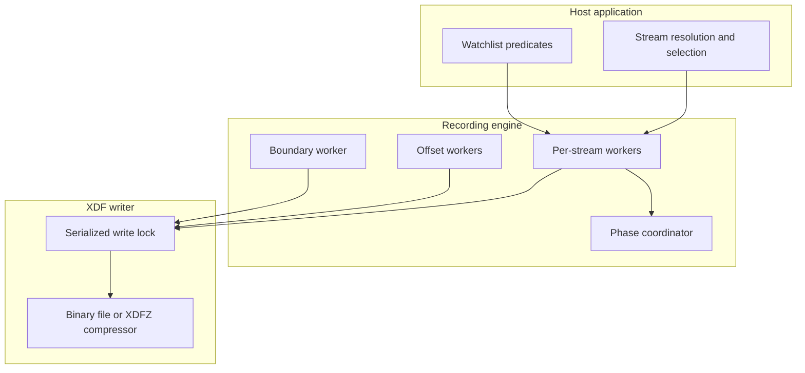
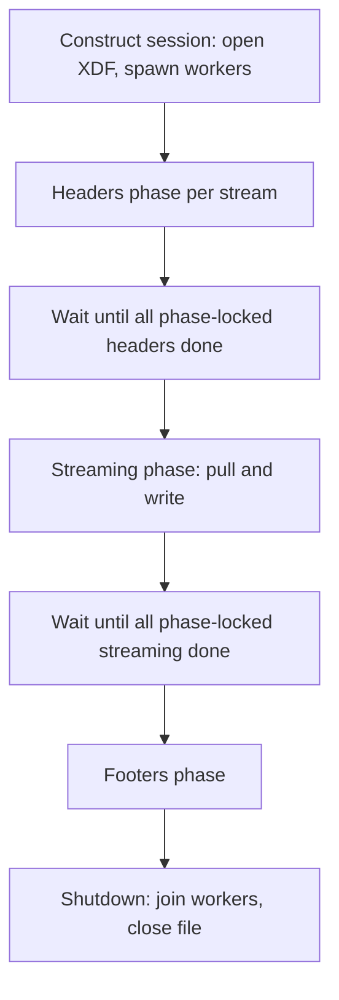

# LSL Receive → XDF Write Specification

**Spec Version:** 1.0  
**Status:** Normative for LabRecorder-compatible recorders  
**Source of truth:** App-LabRecorder C++ implementation  
**Primary references:**

| Layer | Path |
|-------|------|
| Recording orchestration | `src/recording.h`, `src/recording.cpp` |
| XDF binary writer | `xdfwriter/xdfwriter.h`, `xdfwriter/xdfwriter.cpp`, `xdfwriter/conversions.h` |
| Writer fixture | `xdfwriter/test_xdf_writer.cpp` |
| Minimal host (CLI) | `src/clirecorder.cpp` |
| External format wiki | [XDF Specifications](https://github.com/sccn/xdf/wiki/Specifications) |

This document abstracts the LabRecorder recording engine and XDF writer into a **language-agnostic contract**. Implementations in Python, Rust, or other languages SHALL treat the **MUST** requirements as required for XDF interoperability, and **SHOULD** requirements as required for behavioral parity with App-LabRecorder.

Host concerns (Qt GUI, BIDS path templates, TCP remote-control protocol) are **out of scope** except where they feed parameters into the recording engine.

---

## 1. Conformance levels

| Level | Meaning |
|-------|---------|
| **MUST** | Required for a valid LabRecorder-compatible XDF file and correct on-disk semantics. Non-conformance breaks pyxdf / LabRecorder interoperability. |
| **SHOULD** | Required for behavioral parity with App-LabRecorder’s live recording engine. Deviations may still produce valid XDF, but timing, ordering, or recovery semantics differ. |
| **MAY** | Optional host or quality-of-life behavior. |

### Conformance profiles

1. **XDF Writer profile** — implements Section 5 (binary layout) and Section 6 write invariants. Sufficient for offline / fixture writers.
2. **Recording Engine profile** — Writer profile plus Sections 3–4 (lifecycle, LSL pull, offsets, boundaries, phases). Required for a LabRecorder replacement.
3. **Host Application profile** — Engine profile plus discovery UI, filename policy, remote control, etc. (not specified here).

An implementation claiming “LabRecorder parity” MUST satisfy the Writer profile and SHOULD satisfy the Recording Engine profile.

---

## 2. Glossary

| Term | Definition |
|------|------------|
| **LSL stream** | A named Lab Streaming Layer outlet described by `stream_info` (name, type, channel_count, channel_format, nominal_srate, source_id, uid, hostname, XML metadata). |
| **stream UID** | LSL-assigned unique id for one outlet instance (`stream_info.uid()`). Changes if the outlet restarts without a stable source_id recovery story. |
| **source_id** | Optional stable device / serial identifier (`stream_info.source_id()`). Used for recoverable stream deduplication. |
| **XDF streamid** | `uint32` identifier written into XDF chunks for one recorded stream. Allocated by the recorder, **not** equal to the LSL uid. |
| **phase-locked stream** | A stream present in the initial recording set. Participates in Headers → Streaming → Footers barriers. |
| **late stream** | A stream discovered after recording start (watchlist). Not phase-locked; may insert headers/samples mid-file. |
| **implicit timestamp** | A Samples-chunk timestamp encoded as a single `0x00` byte, meaning “continue from the previous sample by the stream’s nominal interval.” |
| **CollectionTime** | ClockOffset field: recorder-local time of the remote clock sample, computed as `now - offset`. |
| **OffsetValue** | ClockOffset field: `inlet.time_correction()` result (seconds to add to stream timestamps to map into recorder time). |
| **multiplexed chunk** | Flat buffer of `n_samples * n_channels` channel values in sample-major order, as returned by LSL `pull_chunk_multiplexed`. |

---

## 3. System architecture

### 3.1 Components



| Component | Responsibility |
|-----------|----------------|
| **Host** | Resolve LSL streams, choose which to record, supply watchlist predicates and optional per-stream postprocessing flags, choose output path, start/stop the session. |
| **Recording engine** | Own one `XdfWriter`, spawn per-stream and auxiliary workers, enforce phase barriers for the initial set, stop cleanly. |
| **Per-stream worker** | Open inlet, write StreamHeader, pull samples, write Samples, stop offset worker, write StreamFooter. |
| **Offset worker** | Periodically measure `time_correction` and write ClockOffset chunks; accumulate footer XML data. |
| **Boundary worker** | Periodically write Boundary chunks. |
| **XdfWriter** | Encode magic + chunks; serialize all writes through one mutex. |

### 3.2 Normative architectural rules

1. There MUST be exactly one writer instance per output file for the lifetime of a recording session.
2. All chunk writes MUST be mutually exclusive (single mutex or equivalent). Concurrent writers without serialization are non-conformant.
3. Implementations NEED NOT use the same number of OS threads as C++ LabRecorder, but they SHOULD preserve the **observable ordering constraints** in Section 6 for phase-locked streams.
4. XDF `streamid` values MUST be allocated monotonically. The reference allocator is: initialize counter to `0`, then `id = ++counter` on each new stream, so the **first streamid is 1**.
5. There is **no required in-memory sample queue**. The reference engine pulls and writes synchronously on the stream worker. Buffering between pull and write is allowed if chunk contents and timestamps are unchanged.

### 3.3 Session construction parameters

A recording session is constructed with:

| Parameter | Type | Meaning |
|-----------|------|---------|
| `filename` | path | Output `.xdf` or `.xdfz`. Truncated/created on open. |
| `streams` | list of `stream_info` | Initial phase-locked streams. |
| `watchfor` | list of LSL predicate strings | Optional late-discovery queries (`resolve_bypred` / `resolve_stream`). |
| `sync_options` | map `name + " (" + hostname + ")" → int flags` | Optional LSL inlet postprocessing flags. |
| `collect_offsets` | bool (default true) | Whether to spawn ClockOffset workers. |

Reference CLI (`LabRecorderCLI`) passes empty `watchfor`, empty `sync_options`, and `collect_offsets=true`.

---

## 4. Recording lifecycle

### 4.1 High-level flow



### 4.2 Per-stream algorithm (`record_from_streaminfo`)

For each stream with parameters `(src: stream_info, phase_locked: bool)`:

#### Phase A — Headers

1. If `phase_locked`: enter headers phase (increment `headers_to_finish`).
2. Create `stream_inlet(src)` with LSL default buffering.
3. If `sync_options` contains key `src.name() + " (" + src.hostname() + ")"`, call `inlet.set_postprocessing(flags)`.
4. Call `inlet.open_stream(max_open_wait)` with `max_open_wait = 5` seconds.
   - On timeout: log a warning; **continue** (subscription delayed; header may still be written).
5. Allocate `streamid = fresh_streamid()`.
6. Write StreamHeader chunk: content = `inlet.info().as_xml()` (full LSL XML, not a reduced subset).
7. If `phase_locked`: leave headers phase (decrement counter; notify streaming waiters).

On any exception in this phase: leave headers phase if entered, then abort this stream worker (no Samples/Footer required after failure).

#### Phase B — Streaming

1. If `phase_locked`: wait until `headers_to_finish <= 0` or `max_headers_wait` (10 s) elapses; then increment `streaming_to_finish`.
2. Read `nominal_srate` from the inlet info.
3. Dispatch a typed transfer loop by `channel_format` (Section 4.4).
4. If `phase_locked`: leave streaming phase (decrement; notify footer waiters).

#### Phase C — Footers

1. If `phase_locked`: wait until `streaming_to_finish <= 0 && headers_to_finish <= 0` or `max_footers_wait` (2 s).
2. Build StreamFooter XML (Section 5.8) using `first_timestamp`, `last_timestamp`, `sample_count`, and accumulated clock offsets for this `streamid`.
3. Write StreamFooter chunk.
4. Leave footers phase (no-op in reference).

### 4.3 Watchlist / late streams (`record_from_query_results`)

For each predicate string in `watchfor`, a dedicated worker SHOULD:

1. Loop until shutdown:
   - Call `resolve_stream(query, minimum=0, timeout=resolve_interval)` with `resolve_interval = 5` seconds.
   - For each result, if the stream is new per the reference dedupe rules below, spawn `record_from_streaminfo(result, phase_locked=false)`.
2. On shutdown, join spawned child stream workers (with the same join/detach policy).

**Reference dedupe (observed App-LabRecorder behavior):**

A resolved stream is started only when **all** of the following hold:

- its `uid` is not in `known_uids`;
- its `source_id` is **non-empty**;
- its `source_id` is not in `known_source_ids`.

Then insert `uid` into `known_uids` and `source_id` into `known_source_ids`.

> Note: Under these rules, watchlist matches with an empty `source_id` are never attached. Recoverable devices that advertise a stable non-empty `source_id` are not started twice after restart. Hosts MAY pre-filter watchlist entries that duplicate already-selected streams (GUI does this).

Late streams MUST NOT participate in phase counters. Their StreamHeader / Samples / Footer MAY appear interleaved with ongoing phase-locked traffic, producing a file that is valid but not strictly “headers-first” sorted.

### 4.4 Typed transfer loop (SHOULD for engine parity)

Inputs: `streamid`, `srate`, `inlet`, outputs: `first_timestamp`, `last_timestamp`, `sample_count`.

```
sample_interval = (srate != 0) ? 1.0 / srate : 0.0

if collect_offsets:
    start offset worker for this streamid/inlet

# First sample
first_timestamp = 0.0
while not shutdown and first_timestamp == 0.0:
    first_timestamp = last_timestamp = inlet.pull_sample(buffer, timeout=4.0)

if not shutdown:
    write_samples(streamid, timestamps=[first_timestamp], multiplexed_values=buffer)
    sample_count += 1

next_pull = now()
while not shutdown:
    n = inlet.pull_chunk_multiplexed(buffer, timestamps, timeout=1e-6)
    for each timestamp ts in timestamps:
        if last_timestamp + sample_interval == ts:   # exact float equality
            last_timestamp = ts + sample_interval
            ts = 0.0                                 # encode as implicit
        else:
            last_timestamp = ts
    write_samples(streamid, timestamps, multiplexed_values=buffer)
    sample_count += len(timestamps)
    next_pull += 500ms
    sleep_until(next_pull)

stop offset worker and join it
```

#### Channel format dispatch

| LSL format | Element type | Supported |
|------------|--------------|-----------|
| `cf_int8` | 8-bit signed integer | MUST |
| `cf_int16` | 16-bit signed integer | MUST |
| `cf_int32` | 32-bit signed integer | MUST |
| `cf_float32` | IEEE754 binary32 | MUST |
| `cf_double64` | IEEE754 binary64 | MUST |
| `cf_string` | UTF-8 / opaque byte string per channel | MUST |
| `cf_int64` | — | MUST NOT (reference throws) |
| other / undefined | — | MUST NOT |

Unsupported formats MUST fail the stream worker (log and exit that worker) without writing invalid sample bytes.

#### Pull API notes

- First sample uses **`pull_sample`** (timeout 4.0 s), not a chunk API.
- Ongoing pulls use **`pull_chunk_multiplexed`** with a **1 microsecond** timeout (drain whatever is buffered), then sleep to keep an approximate **500 ms** cadence.
- Empty pulls (`n_samples == 0`) MUST NOT emit a Samples chunk.
- String channels are one string per channel per sample (not a single joined string).

### 4.5 Clock offset worker (SHOULD)

While offsets are enabled and the stream is streaming:

1. Sleep `offset_interval` (**5 s**). First measurement therefore occurs ~5 s after streaming starts.
2. `offset = inlet.time_correction(timeout=2)`.
3. `now = lsl.local_clock()`.
4. Write ClockOffset chunk via writer API `write_stream_offset(streamid, now, offset)` which stores:
   - `CollectionTime = now - offset`
   - `OffsetValue = offset`
5. Append `(CollectionTime, OffsetValue)` to the in-memory offset list used by the StreamFooter.

On `time_correction` timeout, the reference logs an error and still proceeds to write (implementation SHOULD prefer skipping the write on timeout to avoid undefined values; skipping is a permitted hardening relative to the reference).

### 4.6 Boundary worker (SHOULD)

While not shutdown:

1. Sleep in ~500 ms polls.
2. Every `boundary_interval` (**10 s**), write one Boundary chunk.

### 4.7 Shutdown

1. Set `shutdown = true` (destructor or explicit stop).
2. Stream workers exit transfer loops, stop offset workers, write footers (if they reached that phase).
3. Join stream workers with `max_join_wait` (**5 s**); if still running, detach (reference behavior — implementations SHOULD prefer stronger shutdown guarantees).
4. Join boundary worker with `max_join_wait + boundary_interval`; else detach.
5. Destroy / close the `XdfWriter` (file closed via RAII / explicit close). There is **no** global file-level footer beyond per-stream StreamFooter chunks.

---

## 5. XDF binary format (MUST)

All multi-byte numeric fields are **little-endian**. Floating-point values are **IEC 559 / IEEE 754**. Writers targeting exotic architectures MUST convert explicitly; on LE+IEC559 hosts, native memory images MAY be written.

### 5.1 File layout

```
[Magic "XDF:"] [Chunk]* 
```

- Magic MUST be the four ASCII bytes `XDF:` (`0x58 0x44 0x46 0x3A`).
- Immediately after magic, a FileHeader chunk (tag 1) MUST be written.
- Subsequent chunks MAY appear in any order consistent with Section 6.

### 5.2 Chunk envelope

Every chunk:

```
[Length][Tag][StreamID?][Content]
```

| Field | Encoding | Notes |
|-------|----------|-------|
| Length | VarLenInt | Byte count of `Tag + StreamID? + Content` — **not** including the Length field itself |
| Tag | `uint16` LE | See tag table |
| StreamID | `uint32` LE | Present iff the tag is stream-scoped |
| Content | raw bytes | Tag-specific |

Length computation (reference):

```
len = content_nbytes + sizeof(uint16)           # +2 for tag
if streamid present:
    len += sizeof(uint32)                       # +4
write_varlen_int(len)
write_u16_le(tag)
if streamid present: write_u32_le(streamid)
write(content)
```

### 5.3 Variable-length and fixed-length integers

**VarLenInt** (`write_varlen_int`):

| Condition | Bytes |
|-----------|-------|
| `val < 256` | `[0x01][uint8 val]` |
| `val ≤ 4294967295` | `[0x04][uint32 LE val]` |
| otherwise | `[0x08][uint64 LE val]` |

**FixLenInt** (`write_fixlen_int` for width `N = sizeof(T)`):

```
[N][T little-endian]
```

Used for the Samples chunk `NumSamples` prefix with `T = uint32` (leading length-byte `0x04`).

### 5.4 Chunk tags

| Tag | Name | StreamID? | Content |
|-----|------|-----------|---------|
| 1 | FileHeader | no | XML string |
| 2 | StreamHeader | yes | XML string (LSL `as_xml()`) |
| 3 | Samples | yes | binary sample block |
| 4 | ClockOffset | yes | 16 bytes: two `float64` |
| 5 | Boundary | no | 16-byte UUID |
| 6 | StreamFooter | yes | XML string |

### 5.5 FileHeader (tag 1)

Written once at file open. Reference XML (whitespace significant as emitted):

```xml
<?xml version="1.0"?>
  <info>
    <version>1.0</version>
    <datetime>YYYY-MM-DDTHH:MM:SS±HHMM</datetime>
  </info>
```

- `<version>` MUST be `1.0`.
- `<datetime>` SHOULD be local wall time in ISO-8601-like form (`%FT%T%z` / equivalent). Exact timezone formatting MAY differ across platforms.

### 5.6 StreamHeader (tag 2)

Content MUST be the LSL stream metadata XML from `inlet.info().as_xml()` after subscribe/open. Writers MUST NOT invent a reduced schema when full XML is available.

Minimal illustrative structure (subset of typical LSL XML):

```xml
<?xml version="1.0"?>
<info>
  <name>...</name>
  <type>...</type>
  <channel_count>...</channel_count>
  <nominal_srate>...</nominal_srate>
  <channel_format>float32|double64|int8|int16|int32|string|...</channel_format>
  ...
</info>
```

### 5.7 Samples (tag 3)

Content layout:

```
[FixLenInt NumSamples:uint32]
NumSamples × (
    [TimeStampBytes:uint8]
    if TimeStampBytes == 8: [TimeStamp:float64 LE]
    if TimeStampBytes == 0: (implicit timestamp; no further ts bytes)
    [Channel0][Channel1]...[ChannelN-1]
)
```

#### Timestamp encoding

| Condition | Encoding |
|-----------|----------|
| `ts == 0.0` (implicit) | single byte `0x00` |
| otherwise | `0x08` followed by `float64` LE |

#### Numeric channels

For numeric formats, each sample is `n_channels` consecutive little-endian values of the element type (bulk write of `n_channels * sizeof(T)` bytes per sample). Multiplexed input order is sample-major:  
`s0c0, s0c1, …, s0cN-1, s1c0, …`.

#### String channels

For each channel string:

```
[VarLenInt byte_length][raw bytes]
```

Strings are written as opaque byte sequences (C++ `std::string` contents). Portable writers SHOULD treat them as UTF-8 when the producer uses UTF-8.

#### Empty batches

If `n_samples == 0`, the writer MUST return without emitting a chunk.  
If `timestamps.size() != n_samples`, the writer MUST raise an error.

#### Reference implementation detail

The C++ writer builds the Samples content in a temporary buffer, writing a placeholder FixLen `NumSamples` of `0x0FFFFFFF`, then patches the true `uint32` count into the four bytes after the FixLen width byte. Implementations MAY write the count directly; on-disk result MUST be identical.

### 5.8 ClockOffset (tag 4)

Content (exactly 16 bytes):

| Offset | Type | Field |
|--------|------|-------|
| 0 | `float64` LE | CollectionTime = `now - offset` |
| 8 | `float64` LE | OffsetValue = `offset` |

Writer API shape in reference: `write_stream_offset(streamid, now, offset)` performs the subtraction internally. Callers pass raw `now` and `offset` from LSL.

### 5.9 Boundary (tag 5)

Content MUST be exactly these 16 bytes (UUID):

```
43 A5 46 DC CB F5 41 0F B3 0E D5 46 73 83 CB E4
```

### 5.10 StreamFooter (tag 6)

Reference XML (precision 16 for floating timestamps in C++ `ostringstream`):

```xml
<?xml version="1.0"?><info><first_timestamp>...</first_timestamp><last_timestamp>...</last_timestamp><sample_count>...</sample_count><clock_offsets><offset><time>...</time><value>...</value></offset>...</clock_offsets></info>
```

| Element | Meaning |
|---------|---------|
| `first_timestamp` | Timestamp of the first recorded sample (0 if none) |
| `last_timestamp` | Last **explicit or tracked** timestamp after compression bookkeeping |
| `sample_count` | Total samples written for the stream |
| `clock_offsets/offset/time` | CollectionTime |
| `clock_offsets/offset/value` | OffsetValue |

Optional `<writer>...</writer>` appears in some fixtures/tests but is **not** emitted by the live App-LabRecorder footer builder. Readers MUST tolerate its presence or absence.

### 5.11 XDFZ compression

If the output path ends with `.xdfz` and compression support is enabled:

- The logical byte stream (magic + chunks) is compressed.
- Reference C++ (optional `XDFZ_SUPPORT`) uses Boost `zlib_compressor` over a file sink.
- Portable implementations SHOULD produce gzip-wrapped `.xdfz` as expected by common readers (e.g. pyxdf), and MUST document the compression format they emit.

Uncompressed `.xdf` MUST always be supported.

---

## 6. Ordering and concurrency invariants

### 6.1 MUST

1. Serialize all chunk writes.
2. Write FileHeader before any other chunk.
3. Write a stream’s StreamHeader before any Samples / ClockOffset / StreamFooter for that `streamid`.
4. Do not write Samples with `n_samples == 0`.
5. Do not write Samples for unsupported channel formats.
6. Close the file only after workers have been asked to stop (best-effort join).

### 6.2 SHOULD (phase-locked set)

1. All StreamHeaders for the initial phase-locked set appear before any Samples or ClockOffsets from those streams (bounded wait: 10 s).
2. All StreamFooters for that set appear after those streams finish streaming (bounded wait: 2 s).
3. Boundary and ClockOffset chunks MAY interleave freely with Samples among streams once streaming has begun.
4. Among concurrent stream workers, sample-chunk interleaving is nondeterministic; **byte-identical live files are not required**. Payload equivalence (same samples, timestamps after decompression of implicit zeros, offsets, footers) is the parity bar.

### 6.3 Late streams

Late (non-phase-locked) StreamHeaders MAY appear after other streams’ Samples. Such files are valid XDF but may need sorting for seek-optimized tooling. The reference tracks an `unsorted_` flag conceptually for this case (currently unused in writes).

---

## 7. Timing constants (reference)

| Constant | Value | Role |
|----------|-------|------|
| `boundary_interval` | 10 s | Boundary chunk period |
| `offset_interval` | 5 s | ClockOffset measurement period |
| `resolve_interval` | 5 s | Watchlist resolve timeout/period |
| `chunk_interval` | 500 ms | Pull-loop cadence |
| `max_headers_wait` | 10 s | Phase barrier |
| `max_footers_wait` | 2 s | Phase barrier |
| `max_open_wait` | 5 s | `open_stream` timeout |
| `max_join_wait` | 5 s | Thread join timeout |
| First `pull_sample` timeout | 4.0 s | Wait for first sample |
| `pull_chunk_multiplexed` timeout | 1e-6 s | Drain buffered samples |
| `time_correction` timeout | 2 s | Offset query |
| Boundary poll sleep | 500 ms | Boundary thread wait quantum |
| Join poll sleep | 500 ms | Join wait quantum |

---

## 8. Abstract API surface

Names are illustrative for Python / Rust ports.

### 8.1 `XdfWriter`

```
open(path) -> void
  # truncates file, writes magic + FileHeader

write_stream_header(streamid: u32, xml: str) -> void

write_samples(
    streamid: u32,
    timestamps: [f64],          # 0.0 means implicit
    values: multiplexed[T] | nested[[T]],
    n_channels: u32
) -> void

write_clock_offset(streamid: u32, now: f64, offset: f64) -> void
  # encodes CollectionTime=now-offset, OffsetValue=offset

write_boundary() -> void

write_stream_footer(streamid: u32, xml: str) -> void

close() -> void
```

Thread safety: every public write method MUST take the write lock for the duration of one chunk.

### 8.2 `RecordingSession`

```
RecordingSession(
    path,
    streams: [StreamInfo],
    watchfor: [str] = [],
    sync_options: Map[str, PostFlags] = {},
    collect_offsets: bool = true
)
# starts workers immediately (RAII) OR explicit start() — either is fine
# if host uses explicit start, open() of XdfWriter happens at start

request_stop() -> void
# destructor / context manager also stops and closes
```

### 8.3 Error / timeout policy

| Event | Required behavior |
|-------|-------------------|
| `open_stream` timeout | Log; continue (delayed collection) |
| Unsupported `channel_format` | Fail that stream worker; do not write samples |
| Transfer / pull exception | Stop offset worker; abort streaming for that stream; footer may be skipped |
| `time_correction` timeout | Log; prefer skip write (hardening) |
| Empty pull | No Samples chunk |
| Shutdown during first-sample wait | Exit with `first_timestamp=0`, `sample_count=0`; footer still SHOULD be written if footer phase is reached |

---

## 9. Conformance test suite

Any Recording Engine / Writer implementation MUST provide automated tests covering:

### 9.1 Writer unit tests (equivalent to `test_xdf_writer.cpp`)

1. File begins with `XDF:` and a FileHeader with `<version>1.0</version>`.
2. StreamHeader + Samples for numeric (e.g. int16) and string streams.
3. Implicit timestamps (`0`) round-trip via a reader that expands them using `nominal_srate`.
4. Boundary UUID exact match.
5. ClockOffset CollectionTime / OffsetValue pairing (`write(now, offset)` → stored `(now-offset, offset)`).
6. StreamFooter fields `first_timestamp`, `last_timestamp`, `sample_count`, nested `clock_offsets`.

### 9.2 Reader round-trip

Load written files with **pyxdf** (or an equivalent XDF 1.0 reader) and assert:

- stream names/types/formats/channel counts;
- numeric payloads (`allclose` as appropriate);
- string marker payloads (plain strings, not list-repr artifacts);
- presence of clock offsets when enabled.

### 9.3 Live parity (SHOULD)

Dual-record the same LSL session into App-LabRecorder and the candidate implementation; compare payloads. Timestamp *encoding* may differ if compression differs; compare **effective** timestamps after expanding implicit zeros. Chunk interleaving need not match.

### 9.4 Engine-specific checks (SHOULD)

| Check | Expectation |
|-------|-------------|
| streamid allocation | First recorded stream uses id `1` (unless tests manually force ids) |
| Timestamp compression | Regular-rate sequences encode runs of `0` bytes under exact interval equality |
| StreamHeader XML | Passthrough of `as_xml()` |
| Phase ordering | For an initial N-stream set under normal timing, all N headers precede those streams’ samples |
| Watchlist | Non-empty `source_id` streams matching predicates attach once; duplicates by `source_id` do not |

---

## 10. Worked binary sketch

Conceptual layout after recording two streams (ids 1 and 2):

```
XDF:
[FileHeader tag=1]
[StreamHeader tag=2 streamid=1]
[StreamHeader tag=2 streamid=2]
[Samples tag=3 streamid=1] ...
[Samples tag=3 streamid=2] ...
[ClockOffset tag=4 streamid=1] ...
[Boundary tag=5]
[Samples ...]
...
[StreamFooter tag=6 streamid=1]
[StreamFooter tag=6 streamid=2]
```

Boundary and ClockOffset positions vary with timing. Late streams may insert an additional StreamHeader after Samples have already been written for the initial set.

For a normative fixture with nested/string/numeric samples and offsets, see `xdfwriter/test_xdf_writer.cpp`.

---

## 11. Appendix A — lab-recorder-python gap matrix (non-normative)

Status relative to this spec as of Spec 1.0 authoring. This is a punch list for a future parity PR, not a requirement of this documentation pass.

| Area | Spec expectation | Current Python (`lab-recorder-python`) | Gap |
|------|------------------|----------------------------------------|-----|
| Chunk tags 1–6 + magic | MUST | Implemented in `SimpleXDFWriter` | OK |
| VarLen/FixLen + LE numerics | MUST | Implemented | OK |
| Boundary UUID | MUST | Same bytes | OK |
| ClockOffset formula | MUST | Writer stores caller-provided CollectionTime; recorder computes `now - offset` | OK if callers correct |
| StreamHeader `as_xml()` | MUST | Prefer `as_xml()`, fallback minimal XML | Mostly OK |
| StreamFooter fields | MUST | Tracks stats + offsets | OK; optional `<writer>` only in fixtures |
| Timestamp compression | SHOULD | Live path writes full timestamps; implied ts only for footer bookkeeping | **Gap** |
| `pull_chunk_multiplexed` + 500 ms cadence | SHOULD | `pull_chunk(timeout=0.1)` acquisition threads | **Gap** |
| First `pull_sample` 4.0 s loop | SHOULD | `pull_sample(timeout=1.0)` once at setup | **Gap** |
| Phase barriers | SHOULD | Not implemented | **Gap** |
| Per-stream direct write | SHOULD (architecture) | Central buffer + writer thread | Behavioral difference (allowed if outputs match) |
| `sync_options` / postprocessing | SHOULD | Not implemented | **Gap** |
| Watchlist predicates + source_id dedupe | SHOULD | Periodic `resolve_streams` + attach selected UIDs | **Gap** |
| `collect_offsets` flag | SHOULD | Offsets always collected while recording | Minor |
| `cf_int64` rejection | MUST | Maps int64 in writer tables | **Gap** (should refuse like C++) |
| Flush policy | MAY | Flush after every chunk | OK (stricter) |
| XDFZ | MUST document | `gzip.open` | Different from optional Boost zlib; usually fine for pyxdf |
| Dual-record tests | SHOULD | `tests/test_dual_xdf_recording.py` | Present |
| Writer round-trip tests | MUST | `tests/test_xdf_roundtrip.py` | Present |

### Recommended Python parity order

1. Enable live timestamp compression matching Section 4.4.
2. Align pull API / timeouts / cadence with Section 4.4 (or prove equivalent buffering).
3. Add phase barriers for the initial stream set.
4. Add `sync_options` and watchlist predicate semantics.
5. Reject `cf_int64` in the recording path.
6. Keep dual-record + pyxdf tests green as the acceptance gate.

---

## 12. Appendix B — Reference file map

| Concern | File |
|---------|------|
| Constants, phase API, class layout | `src/recording.h` |
| Workers, pull loop, offsets, footers | `src/recording.cpp` |
| Chunk tags, Samples templates, `write_ts` | `xdfwriter/xdfwriter.h` |
| Magic, FileHeader, envelope, ClockOffset, Boundary | `xdfwriter/xdfwriter.cpp` |
| Endian helpers, VarLenInt, string samples | `xdfwriter/conversions.h` |
| Golden writer usage | `xdfwriter/test_xdf_writer.cpp` |
| Minimal session construction | `src/clirecorder.cpp` |
| OnlineSync flag parsing (host) | `src/mainwindow.cpp` |

---

## 13. Change control

- **Spec 1.0** captures observed App-LabRecorder behavior used as the multi-language SoT.
- Future behavior changes in the C++ reference SHOULD bump this document in the same change set.
- Language ports MUST cite the Spec Version they target in their README / crate docs.
